# wayland-desktop

> [!TIP]
> Documentation [TsukiNi22/wayland-desktop](https://tsukini22.github.io/wayland-desktop/) (v0.1.0) and
> [live demo](https://tsukini22.github.io/wayland-desktop/poc/index.html).

Six interactive desktop styles in HTML / CSS / JS, built on one small kit, to compare the looks before writing the real
Wayland configuration. Every style has working windows, a lock screen, files, a browser, a terminal, music and settings.

### Table of Contents
 - [Themes](#themes)
 - [Lock screens](#lock-screens)
 - [Wayland configs](#wayland-configs)
 - [Usage](#usage)
 - [Branches](#branches)
 - [Credits](#credits)

## Themes

| | | |
| ---- | ---- | ---- |
| 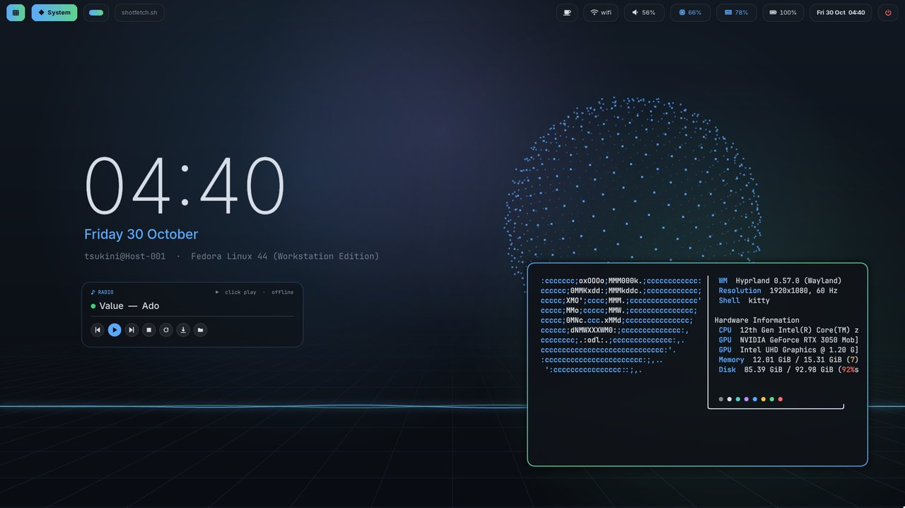 | 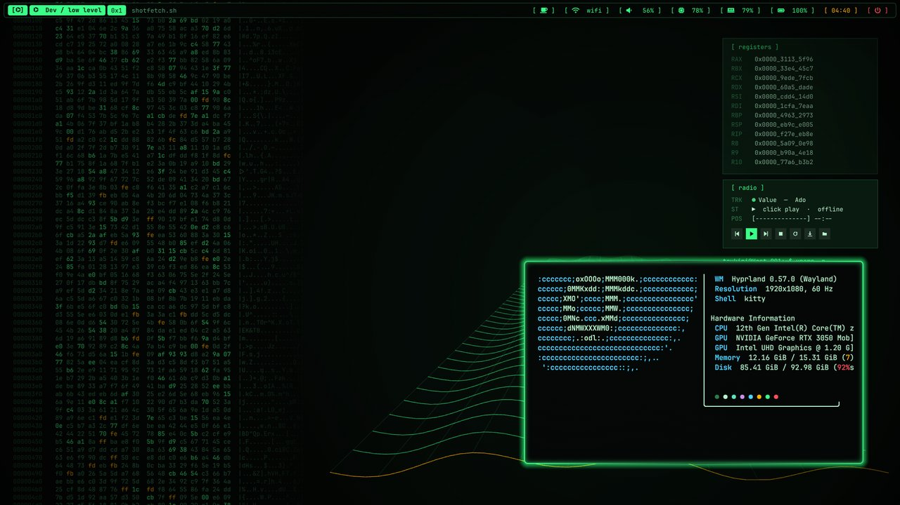 | 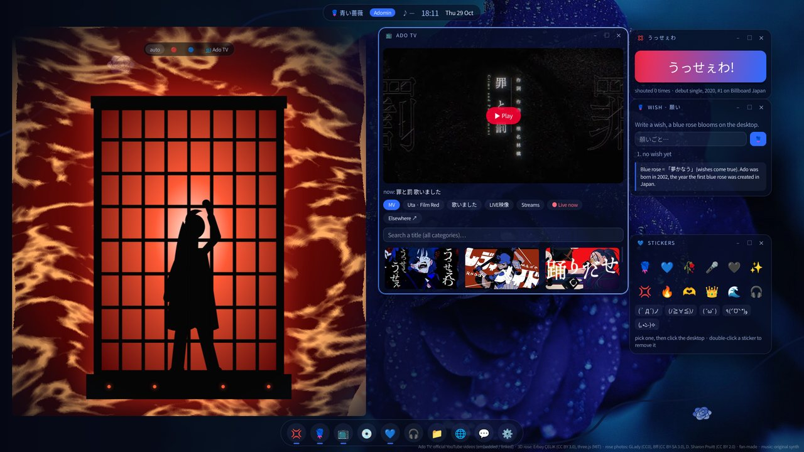 |
| [**System**](https://tsukini22.github.io/wayland-desktop/poc/system.html) | [**Dev / low level**](https://tsukini22.github.io/wayland-desktop/poc/dev.html) | [**Ado / blue rose**](https://tsukini22.github.io/wayland-desktop/poc/jpop.html) |
| Hyprland-like rice, live monitor, quick settings | playable debugger, registers, memory | Ado Box, Ado TV, 3D blue roses |
| | | |
| 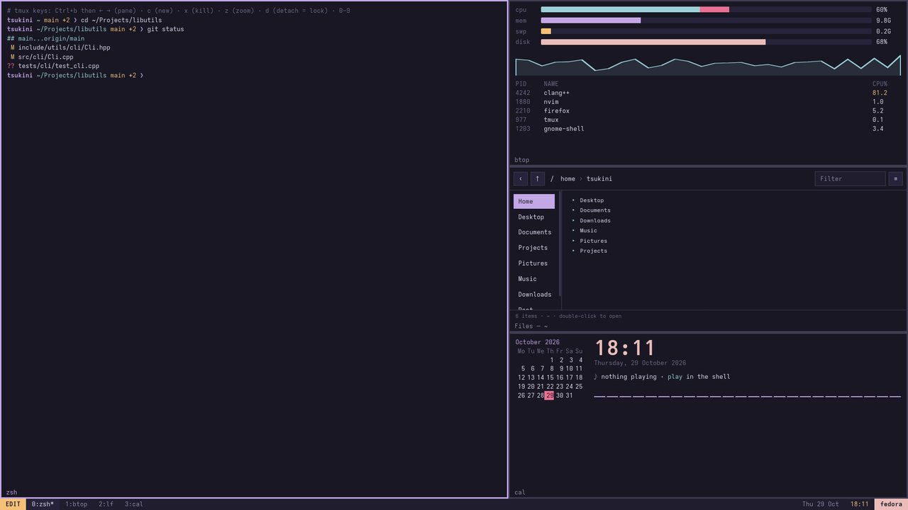 | 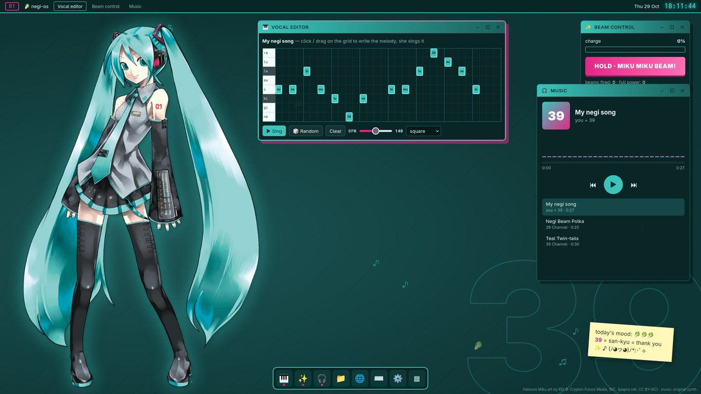 | 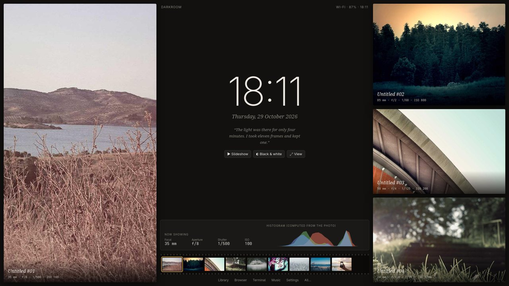 |
| [**Terminal / better-tty**](https://tsukini22.github.io/wayland-desktop/poc/tty.html) | [**Miku**](https://tsukini22.github.io/wayland-desktop/poc/miku.html) | [**Photographer**](https://tsukini22.github.io/wayland-desktop/poc/photographer.html) |
| tmux tiling with `Ctrl+b`, rose-pine | vocal editor she sings, MIKU MIKU BEAM | photo wall, lightbox, real histogram |

## Lock screens

| | | |
| ---- | ---- | ---- |
| 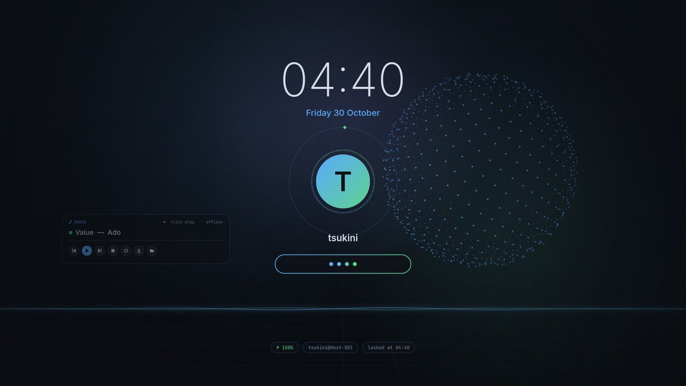 | 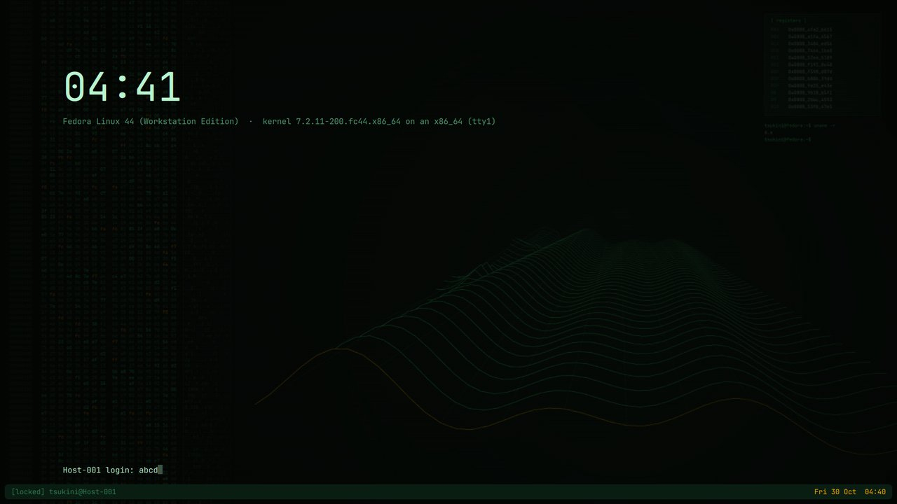 | 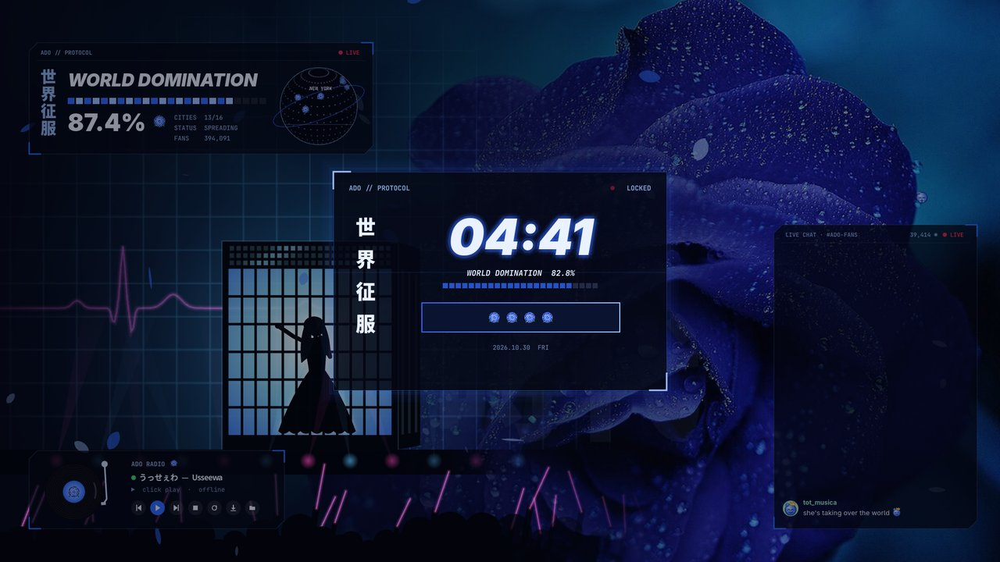 |
| **System** | **Dev / low level** (BIOS prompt) | **Ado / blue rose** |
| | | |
| 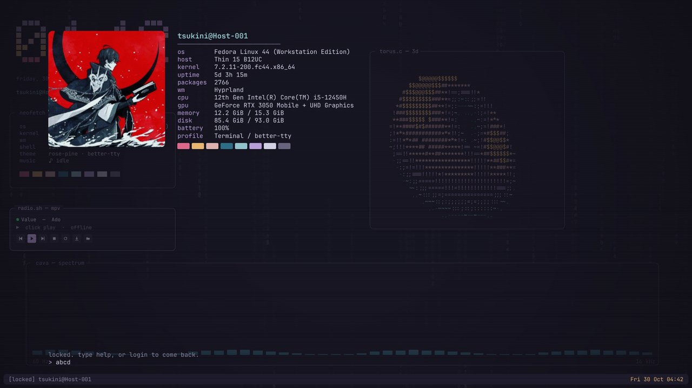 | 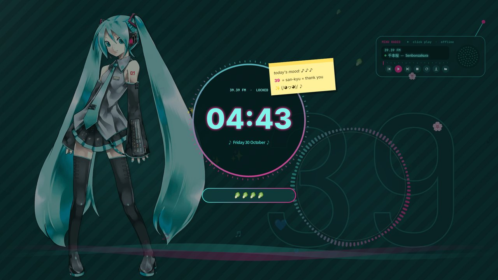 | 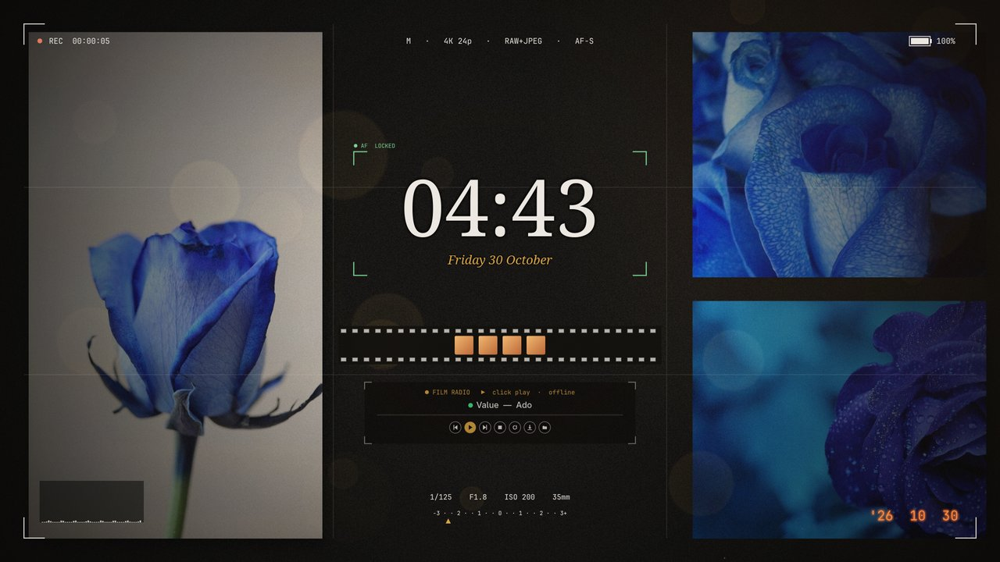 |
| **Terminal / better-tty** (getty login) | **Miku** | **Photographer** (viewfinder) |

In the Wayland session, the lock shows the session itself behind it (its windows, a little darker), for every style
but Dev and its own console: System a card of glass (light clock, date, battery and network), Miku the LCD of the
39.39 FM with the sticky note of the POC and leeks for dots, Ado the HUD of her page (世界征服, WORLD DOMINATION: the
part of the year done) with blue flowers for dots, Photographer a viewfinder (REC, battery, an AF frame around the
password, the exposure line, the date printed on the film), Terminal its shell over a capture of the screens.

## Wayland configs

> Hyprland (Lua config, 0.55+), waybar, wofi, kitty, hyprlock and mako configs inspired by the POCs, a GNOME-like overview
> (quickshell) and live wallpapers that follow the music, in `config/`

```bash
./install.sh                    # asks
./install.sh all                # every style + the switcher in the top bar
./install.sh tty                # one style alone: system, dev, ado, tty, miku, photographer
./install.sh --no-packages all  # the configs only
./install.sh remove             # remove the configs and put back the saved files (the packages stay)
```

`install.sh` first installs the packages of the chosen config for the distribution (sudo asked once, only when one is
missing), then the configs for the user; run through `sudo`, it installs the packages and gives the configs to `$SUDO_USER`
(what the `Wayland` setup of [dump](https://github.com/TsukiNi22/dump) does with the chosen mode).

| Family | Packages |
| ------ | -------- |
| fedora-like | `dnf`, copr `sdegler/hyprland` for Hyprland and hyprlock |
| debian-like | `apt` (Debian 13+, recent Ubuntu) |
| arch-like | `pacman` |

> [!NOTE]
> Every config: Hyprland, hyprlock, waybar, wofi, kitty, swaybg, mako, grim, slurp, wl-clipboard, brightnessctl, playerctl,
> wireplumber, libnotify, nautilus, btop, quickshell (overview, lock of better-tty and Dev), cava (music), python GTK +
> WebKit 4.1 + gtk-layer-shell (live wallpapers), Pillow (animated cursors), the Adwaita cursor and the fonts (JetBrains
> Mono, Font Awesome, Noto CJK, Noto Sans Symbols 2, Noto Color Emoji); each style adds the `PACKAGES` of its `style.env`
> (its font, `mpv` + `yt-dlp` + `mpv-mpris` for the radio of Ado and Miku, `ffmpeg` for the clips of their pages). A package missing in the repositories of the family is skipped: the overview falls back to the wofi
> launcher, the wallpaper to the still image, the radio tells what it needs.

| Mode | Content |
| ---- | ------- |
| `all` | every style, the switcher module in the top bar (click: menu, scroll: next / previous), `wd-style` |
| `<style>` | only that style, no switcher |

| Keys | Effect |
| ---- | ------ |
| `Super` (alone) / `Super` again or `Super+A` | overview of the workspaces and their windows / applications grid (typing searches); `Super` twice quickly opens the applications at once |
| in the overview: `←` `→` then `Enter`, a click | pick a workspace card, go there; on the last empty card it creates the workspace (the arrows never create one) |
| drag a window in the overview | to another workspace, or to the last empty one to create a workspace (GNOME: an emptied workspace goes away, the next ones move down) |
| `Super+Return` / `Super+Q` | terminal (kitty) |
| `Super+E` | files (Nautilus, on this screen even with a GNOME session open next to Hyprland) |
| `Super+R` | launcher (wofi) |
| `Super+Shift+W` / `Super+Alt+W` | style menu / next style (`all` mode) |
| `Super+1` - `Super+0` | workspaces (key codes: azerty and qwerty), `+Shift`: move the window there |
| `Ctrl+Alt+arrows`, `Super+Page_Up/Down`, `Super+Alt+left/right` | previous / next workspace, `+Shift`: with the window |
| `Alt+Tab` / `Super+Tab` | next window / last workspace |
| `Super+S` / `Super+Shift+S` | scratchpad / move the window to it |
| `Super+L` / `Super+X` | lock / power menu |
| `Super+C` / `Super+F` / `Super+V` | close / fullscreen / floating |
| `Super+N` / `Super+Shift+N` | last notification again / dismiss them all |
| `Super+Shift+B` / `Super+Shift+C` | live / still wallpaper, cursor: art (the default: Miku and Ado as pixel chibis with a pose for each cursor - peeking under the pointer, tapping with a leek / a microphone, asleep / puffing while it waits, shaken while a window moves, pulling the resize arrows, arms crossed when it is forbidden; for the others every shape in the look of the style and animated itself - a finger tapping, fingers flexing, arrows stretching, the arrow filling up while it waits, a spinner of the style) / the arrow and the mascot of the style / normal |
| `Super+Shift+M` | shows / hides the small radio of System, Dev, Terminal and Photographer |
| `Super+F1` | every key and control in a card (type to filter) |
| `Print` / `Shift+Print` | screenshot of a zone (clipboard) / of the screen (`~/Pictures`) |

| Style | Live wallpaper (`config/styles/<style>/wallpaper.html`) |
| ----- | ------------------------------------------------------ |
| System | aurora, a 3D sphere of points pushed by the music, perspective grid, waveform, light clock |
| Dev / low level | scrolling hex dump, 3D terrain of the last seconds of the spectrum, registers, phosphor CRT |
| Ado / blue rose | her stage from official live videos, one clip after the other for their colors (the blue Ado Box of K-Arena, the red theater of the Tokyo Dome, the fire of Hibana, the lasers of Odo, the golden sun of the Budokan, the cage of Usseewa), melted into the rose (a drawn stage until they are made), WORLD DOMINATION and its globe of conquered cities, a live chat with the rose-chan emotes, giant song titles, the blue rose, a vinyl radio to click |
| Terminal / better-tty | ASCII 3D torus in a tmux pane, rose-pine spectrum, block clock, neofetch pane, glyph rain, CRT |
| Miku | ring of spectrum around the 39, rising notes, twin-tail ribbons, the 39.39 FM radio to click, the sticky note of the POC (click it: the count, then the MIKU MIKU BEAM of its official video) |
| Photographer | light leak, bokeh, film grain and dust, viewfinder |

| Lock (`Super+L`) | |
| ---------------- | - |
| Terminal / better-tty | a shell: fastfetch block (the image of your fastfetch, the stats of the PC), `> ` prompt: `login` (then the password), `switch <profile>` (Tab completes), `whoami`, `profiles`, `help`, `music`, `suspend` / `reboot` / `poweroff`, and `sudo`, `sl`, `cowsay`, `matrix`, `hack`... for fun |
| Dev / low level | a getty: the info of the lock, then `login:` and `Password:` |
| the others | hyprlock, the lock screen of the style (the password shows as emojis in Ado and Miku) |

> [!TIP]
> The radios play their `radio.json` (Ado: 21 tracks, Miku: 18, the others: Value), every track kept offline: downloaded
> once by `install.sh` with yt-dlp in `~/.local/share/wd-radio` (a personal copy, never in this repository, about
> 140 MB), they start at once and play without network; the tracks you add yourself to `online.md` play from YouTube
> (mpv + yt-dlp) until you save them. The pages show parts of official videos
> cut once with ffmpeg in `~/.local/share/wd-radio/media` (personal copies too): the beam of M@GICAL☆CURE! LOVE ♥ SHOT!
> for the Miku beam, wide shots of the stage of six official live videos for the Ado stage. The title, the media keys and the bar follow (mpv-mpris); they keep playing across a change of
> style and stop with the live wallpaper. Your own emotes (png, gif, webp...) in `~/.local/share/wd-emotes` join the
> rose-chan ones in the Ado chat.

The radio of a style is its folder, `~/Music/wd-radio/<style>/` (the music folder of your language): its `.mp3` files,
and `online.md` for the tracks played from YouTube, one per line (`- Title — Subtitle | YouTube link or search`; made
from the tracks of the style, made again when deleted). Anything else put there (other files, other `.md`, folders) goes
to its `ignored/` folder, never deleted (`name (1).ext`, `name (2).ext`... when the name is taken). A change of the folder
reaches the pages and the playing list in a few seconds, the music goes on.

| How | Effect |
| --- | ------ |
| the folder button of the player | opens the folder of the radio |
| the `⤓` button of the player | saves the track as an mp3 where you choose (a save dialog, the folder of the radio by default), then plays it offline |
| the loop button of the player | loops the current track (a setting: it can be changed while nothing plays) |
| `wd-style radio add <style> <url\|mp3\|search> [title [subtitle]]` | adds a link or a search to `online.md`, or copies an mp3 into the folder |
| `wd-style radio list [style]` / `remove <style> <index>` | the tracks with their index, source and state / removes one (an mp3 goes to `ignored/`) |
| `wd-style radio offline <style> <index\|all> [on\|off]` | keeps online tracks offline (downloads them now) or not |

System, Dev, Terminal and Photographer have a small radio fitted into their page, with the same buttons (it comes with
Ado's Value): under the clock, a `[ radio ]` block under the registers, a tmux pane, a line of the viewfinder.
`Super+Shift+M` or `wd-style radio show | hide | toggle [style]` hides or shows it.

A dot before the title of every radio tells where its track is: green on this computer (an mp3 of the folder, a track
kept offline), yellow online, violet (pulsing) while it loads or downloads, red when it can't play (mpv could not load
it in the last 10 minutes, or an online track without network).

> [!IMPORTANT]
> The files already there are saved once (`<file>.wd-backup`) and put back by `./install.sh remove`;
> `~/.config/hypr/user.lua` (keyboard detected at the install) is yours and never replaced.

> [!WARNING]
> Hyprland started from a TTY (`login` then `Hyprland`) while a GNOME session of the same user runs breaks the GNOME
> unlock: Hyprland makes its logind session a `wayland` one, and GDM unlocks the newest graphical session of the user
> (the Hyprland one), so the GNOME lock screen accepts the password and stays there. Quit Hyprland (`Super+M`) before
> going back to GNOME, or start it from the GDM login screen instead (one session at a time).

## Usage

```bash
git clone -b poc https://github.com/TsukiNi22/wayland-desktop.git
cd wayland-desktop
./serve.sh              # http://localhost:8039/index.html, opened in the browser
./serve.sh jpop.html    # open a given page
```

| Key / action | Effect |
| ------------ | ------ |
| `1` - `7` | scenes: desktop, lock, files, browser, terminal, music, settings |
| `Ctrl+Space` | launcher |
| right-click on the desktop | menu of the style |
| title bar: drag / double-click | move / maximize a window |

> [!NOTE]
> Opening `index.html` directly (`file://`) works too, except the YouTube videos of the Ado page: YouTube refuses its embedded
> player on `file://` pages, each video then opens on YouTube.

## Branches

| Branch | Content |
| ------ | ------- |
| `main` | the Wayland configs (`config/`, `install.sh`), this README and its screenshots (`docs/images/`) |
| `poc` | the POCs at the root: `kit/` (shared kit), one `*.html` per style, `assets/`, `vendor/` (three.js), `serve.sh` |
| `gh-pages` | the [documentation site](https://tsukini22.github.io/wayland-desktop/) and the [live demo](https://tsukini22.github.io/wayland-desktop/poc/index.html) (`poc/`) |

## Credits

> [!CAUTION]
> The MIT license of this repository covers the code only (the wallpapers of `config/styles/` reuse the POC images,
> same licenses, see [`config/CREDITS.md`](config/CREDITS.md)). The assets keep their own licenses (CC0, CC BY, CC BY-SA, and the
> non-commercial Crypton license for the Hatsune Miku art): see [`assets/CREDITS.md`](https://github.com/TsukiNi22/wayland-desktop/blob/poc/assets/CREDITS.md).
> The Ado page only links / embeds the official YouTube videos, nothing of them is stored here.
